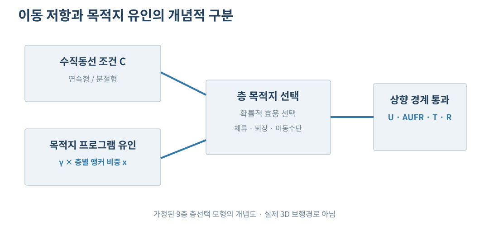
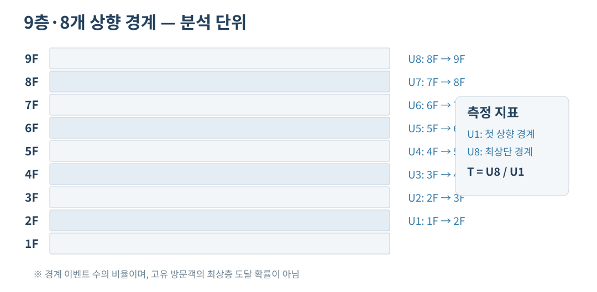
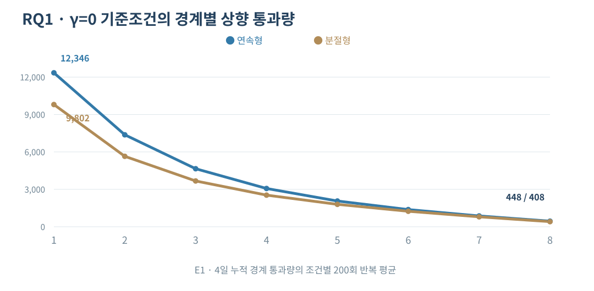
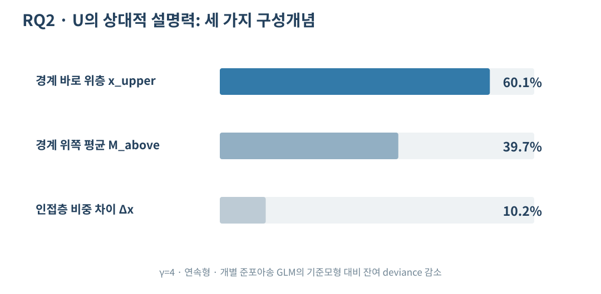
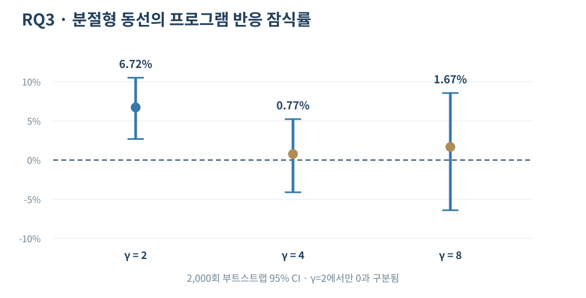
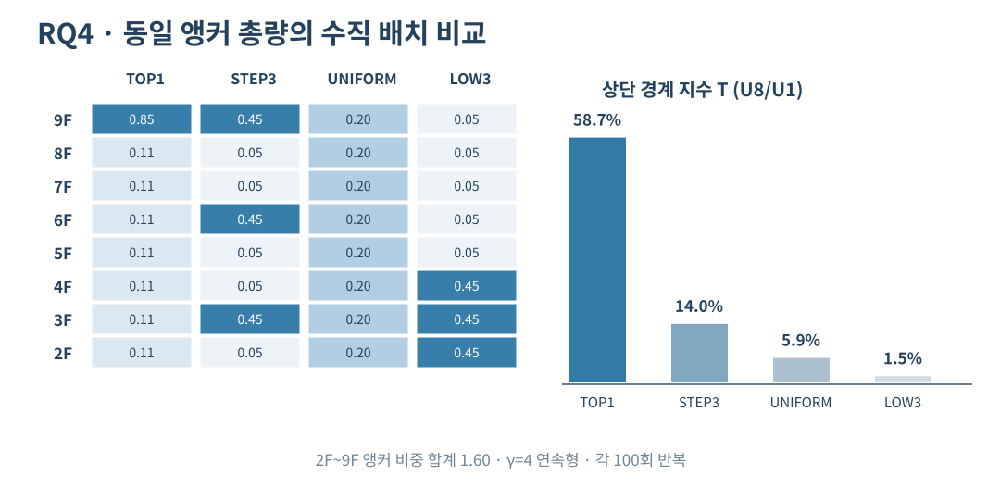

# 가상 다층 상업시설의 프로그램 유인과 수직동선 조건에 따른 층간 상행유량 변화

**― 에이전트 기반 시뮬레이션을 활용한 민감도 및 수직 배치 비교 ―**

**봉성현**  |  성균관대학교 건축학과

**Variations in Inter-Floor Upward Flow by Program Attraction and Vertical Circulation Conditions in a Synthetic Multi-Level Commercial Facility: An Agent-Based Sensitivity and Allocation Study**

## Abstract

In multi-level commercial facilities, vertical travel resistance and destination attractiveness may jointly influence pedestrian circulation, making their separate roles difficult to identify from observations alone. This study examines upward boundary-crossing flows using a non-spatial agent-based model of a synthetic nine-floor commercial facility. Experiment E1 compares four assumed levels of destination-program attraction (γ = 0, 2, 4, and 8) and two vertical circulation conditions, with 200 replicates per condition. Experiment E2 compares four program-allocation patterns under an equal total allocation, with 100 replicates per condition. Under γ = 0 with continuous circulation, the mean four-day cumulative flow declined from 12,346 crossings at the first upward boundary to 448 at the uppermost boundary. Under γ = 4 with continuous circulation, adding the upper-floor program share to a boundary- and replicate-adjusted quasi-Poisson model reduced its remaining deviance by 60.1%, compared with 39.7% for the mean share above the boundary and 10.2% for the adjacent-floor contrast. Fragmented circulation reduced baseline upward flow, while a statistically distinguishable reduction in attraction sensitivity was found only at γ = 2. Under the equal-allocation comparison, the uppermost-to-first-boundary flow index was 58.7% for the top-concentrated pattern and 14.0% for the stepping pattern. These results demonstrate conditional relationships within the specified model rather than externally validated design effects. They suggest that vertical circulation resistance and destination-program allocation should be evaluated together, subject to validation using observed pedestrian movements and spatially explicit models.

**Keywords:** multi-level commercial facility; upward boundary flow; destination attraction; vertical circulation; agent-based simulation; program allocation

## 초록

다층 상업시설에서 상층부로 이어지는 보행 흐름은 층간 이동의 저항과 목적지 프로그램의 유인력이 함께 작용하는 과정에서 형성된다. 그러나 실제 시설에서는 수직동선, 매장 구성, 면적과 출입 조건이 동시에 달라져 두 요인의 역할을 구분하기 어렵다. 본 연구는 비공간적 가상 9층 상업시설을 대상으로 상향 층간 경계 통과량을 분석단위로 설정하고, GAMA 기반 에이전트 시뮬레이션을 통해 프로그램 유인 강도와 수직동선 조건, 앵커의 수직 배치를 비교하였다. E1에서는 유인 강도 γ=0·2·4·8과 연속형·분절형 동선을 교차한 8개 조건을 각 200회 반복했고, E2에서는 총 앵커 비중을 고정한 네 가지 배치를 비교하였다. 추가 앵커 유인이 없는 γ=0 연속형에서 4일 누적 상향 경계 통과량의 반복 평균은 첫 경계 12,346회에서 최상단 경계 448회로 감소하였다. γ=4 연속형에서는 경계·반복 효과를 포함한 기준모형에 경계 바로 위층의 프로그램 비중을 추가했을 때 잔여 deviance가 60.1% 감소하여, 상층부 평균 비중(39.7%)과 인접층 비중 차이(10.2%)보다 높은 설명력을 보였다. 분절형 동선은 기준 유량의 절대 수준을 낮췄으나, 프로그램 반응 기울기의 유의한 잠식은 γ=2에서만 확인되었다. 동일 총량을 배분한 E2에서는 최상단 경계 대 첫 경계의 유량비가 최상층 집중형 58.7%, 징검다리형 14.0%로 나타났다. 이 결과는 설정된 선택모형의 조건부 귀결로서, 실제 상업시설에서의 최적 배치나 고유 방문객의 도달률을 실증한 것은 아니다. 본 연구는 수직동선 조건과 상층부 목적지 유인을 함께 검토할 필요성을 제시한다.

**주제어:** 다층 상업시설, 상행 경계 통과량, 앵커 프로그램, 수직동선 마찰, 에이전트 기반 모형, 프로그램 수직 배치

---

# 1. 서론

## 1.1 연구 배경과 문제 제기

다층 상업시설의 건축계획에서는 방문객이 여러 층을 거쳐 이동하도록 만드는 수직동선의 구조와 각 층에 배치되는 상업·문화 프로그램을 함께 고려해야 한다. 상층부로 이동하려면 수단을 선택하고, 층간 이동에 소요되는 시간과 비용을 감수해야 한다. 반면 특정 목적지가 충분히 매력적이라면 방문객은 중간 층을 지나서라도 상부층을 선택할 수 있다. 따라서 **상층부로 이어지는 보행 흐름은 이동 저항만으로 설명할 수도, 프로그램의 집객력만으로 설명할 수도 없다.**

기존 건축·도시공간 연구는 보행량의 형성에 공간구조와 목적지 유인이 함께 관련된다는 논의를 제시해 왔다. Hillier 등[1]의 자연 이동 이론은 통로 및 연결망의 구성과 유인 요소를 구분하는 이론적 관점을 제공하며, Chang과 Penn[2]은 다층 도시 복합공간의 이동에 여러 공간적 제약이 작용하는 문제를 검토하였다. 최근의 상업시설 연구에서는 실제 평면과 가시성 분석 또는 에이전트 기반 모형을 통해 보행 분포를 예측하고 비교하는 접근도 나타난다[6, 7]. 다만 실제 시설을 대상으로 할 때는 매장 구성, 면적, 출입구와 동선 조건이 동시에 달라지기 때문에, 특정 조건을 바꾸었을 때의 보행 흐름 변화를 별도로 비교하기 어렵다.

본 연구는 이러한 비교 문제를 **층간 경계를 위쪽으로 통과하는 누적 유량**으로 좁힌다. 개별 매장 앞 체류 인원이나 전체 건물 방문객 수가 아니라, 연속한 두 층 사이의 상향 통과 이벤트를 동일한 단위로 집계한다. 이를 통해 이동 조건을 바꾼 경우와 프로그램 유인 강도 또는 배치만 바꾼 경우의 결과를 비교한다. 연구의 관심은 특정 실제 쇼핑몰의 설계를 재현하는 데 있지 않고, **명시한 층 선택 규칙에 따라 나타나는 상행유량 분포와 그 민감도**를 살펴보는 데 있다.

## 1.2 연구 목적, 질문과 범위

본 연구의 주된 질문은 다음과 같다. **가상 다층 상업시설에서 수직동선의 저항과 목적지 프로그램의 유인은 층간 상행유량에 어떻게 관계하며, 동일한 프로그램 총량을 수직으로 다르게 배분할 때 유량 분포가 어떻게 달라지는가?** 이를 네 단계의 연구질문으로 구분하였다. RQ1은 목적성 앵커의 추가 유인이 없는 기준조건에서 높이에 따른 유량 변화를 확인한다. RQ2는 인접층의 프로그램 비중 차이와 경계 위쪽 프로그램 비중 가운데 무엇이 경계 유량을 더 잘 설명하는지 비교한다. RQ3는 동선 분절에 따른 **유량의 절대 수준 변화와 프로그램 반응 민감도의 변화**를 구분한다. RQ4는 앵커 총량이 동일할 때 수직 배치별 상단 경계 유량비를 비교한다.

연구 대상은 1F부터 9F까지의 **가상 9층·8개 경계**로 제한한다. 시뮬레이션은 각 층을 선택할 확률과 이동수단 선택, 체류·퇴장 및 경계 통과를 계산하는 **층 단위 비공간적 선택모형**이다. 실제 건축물의 층별 평면, 매장 내부 보행 궤적, 아트리움 시야, 보행 혼잡과 임대 수익은 모형에 포함하지 않는다. 따라서 이 연구의 결과는 설정한 가상 조건에서의 비교이며, 실측 보행량으로 검증된 일반적 설계법칙으로 해석하지 않는다.

# 2. 이론적 틀과 연구질문

## 2.1 공간구조의 저항과 목적지 프로그램의 유인

자연 이동 이론은 보행분포를 이해할 때 공간구조의 연결 특성과 상업적·사회적 유인을 구분할 필요가 있음을 설명한다[1]. 다층공간에서는 이동 거리가 수평으로만 발생하지 않으며, 층간 이동수단과 환승·우회가 추가적인 선택 비용을 만든다[2]. 한편 상업시설 이용자는 공간적 접근성뿐 아니라 방문하고자 하는 점포나 목적지의 매력에 반응한다. Huff[3]의 상업 목적지 선택과 McFadden[4]의 이산선택 접근, Borgers와 Timmermans[5]의 소매 보행 선택모형은 이러한 선택을 효용의 차이로 이해하는 방법론적 배경을 제공한다.

본 연구는 이러한 이론을 **직접적인 공간구문론 지표의 검증**에 사용하지 않는다. 실제 가시성 그래프, 통합도, 연결도 또는 경로의 기하학적 형태를 계산하지 않았기 때문이다. 대신 공간구조는 층 간 이동비용과 수직동선 시나리오로, 목적지 유인은 층별 프로그램 비중에 곱해지는 효용계수로 단순화한다. 이 단순화는 두 조건을 명확하게 비교할 수 있다는 장점이 있지만, 실제 입체 상업공간의 복잡성을 표현하지 못한다는 한계를 가진다.

## 2.2 층 선택의 효용과 경계별 상행유량

모형에서는 방문객 집단이 특정 층을 목적지로 선택할 때 목적지 자체의 매력과 그곳까지 이동하는 비용을 함께 고려한다. 목적지 층 j에 대한 효용의 핵심 부분은 다음과 같이 요약할 수 있다.

**목적지 선택 효용 = 기초 층 매력 + γ × 목적지 앵커 비중 − 층간 이동·수단 비용 + 방향 편향**

여기서 γ는 목적성 앵커 비중에 부여하는 **가정된 유인 강도**로서 0, 2, 4, 8의 민감도 분석값이다. 실제 식당이나 영화관에서 추정한 선호계수가 아니다. 수직동선 조건은 에스컬레이터 이동에 수반되는 시간과 고유 불편 비용을 변경하는 별도의 축이다. 두 축을 독립적으로 설정해야 γ를 마찰계수처럼 해석하는 오류를 피할 수 있다.

방문객은 여러 층 위를 목적지로 직접 선택할 수 있으며, 그 과정에서 지나가는 모든 층간 경계의 상향 통과량에 기여한다. 따라서 특정 경계에서의 유량은 바로 인접한 상부층만의 선택이 아니라 **그보다 높은 여러 층을 목표로 하는 이동**도 포함한다. 이 점이 프로그램의 인접층 대비뿐 아니라 목적지 프로그램의 절대적 비중과 경계 위쪽 평균 비중을 함께 비교해야 하는 이유다.

*그림 1. 본 연구의 개념적 분석구조. 동선 저항과 프로그램 유인 강도는 가상 층 선택에 함께 관여하며, 결과는 경계별 상행 통과 이벤트로 집계한다. 실제 보행 궤적 또는 공간구문론 분석도는 아니다.*

## 2.3 경쟁 설명과 연구질문

인접층 사이의 프로그램 비중 차이가 상행 흐름을 유인한다는 가정을 먼저 설정할 수 있다. 경계 b의 바로 위층 앵커 비중을 x_upper, 아래층 비중을 x_lower라 하면 그 차이는 **Δx_b = x_upper − x_lower**로 나타난다. 그러나 방문객이 여러 층 위의 목적지를 직접 선택하는 구조라면, 상대적인 차이보다 **경계 바로 위층의 앵커 비중(x_upper)** 또는 **경계 위쪽 층들의 평균 앵커 비중(M_above)**이 유량과 더 밀접하게 연결될 수 있다. 본 연구는 이 세 지표를 경쟁적인 설명으로 비교한다. 이는 인접층 대비의 관련성이 전혀 없다는 가설을 미리 전제하는 것이 아니다.

**표 1. 연구질문과 분석대상의 대응**

| 연구질문 | 분석하려는 문제 | 핵심 지표 | 실험 |
|:---|:---|:---|:---|
| RQ1 | 앵커 추가 유인이 없을 때 높이별 기준 감쇠는 어떠한가? | U, AUFR, RUI | E1·γ=0 |
| RQ2 | 인접층 차이와 위층 프로그램 비중 중 어떤 설명이 더 적합한가? | Δx→AUFR 연관성; U의 잔여 deviance 설명력 | E1·γ>0 |
| RQ3 | 동선 분절은 유량 수준과 프로그램 반응 기울기를 각각 바꾸는가? | U1; AUFR 기울기·잠식률 | E1·연속/분절 |
| RQ4 | 고정된 앵커 총량의 수직 배치에 따라 상층 경계 유량비가 달라지는가? | T, R | E2·네 배치 |

RQ1은 결과 해석의 기준선이며, RQ2가 논문의 중심적인 **설명변수 비교**, RQ3가 그 설명의 **동선 조건**, RQ4가 **공간계획적 배치 시나리오**에 해당한다. 이 연구질문들은 서로 독립적인 실험의 단순한 나열이 아니라, 동일한 선택모형 안에서 순차적으로 비교 범위를 넓히는 구조를 가진다.

# 3. 연구방법

## 3.1 모형의 공간적 범위와 행동 과정

분석 대상은 S00(1F)부터 S08(9F)까지의 가상 상업시설이며, 상향 경계는 b1(1F→2F)부터 b8(8F→9F)까지 8개다. 1F에 가상 주출입구를 두고, 각 경계에서 계단·에스컬레이터·엘리베이터 이용을 모형화하였다. 층별 면적의 기준값을 동일하게 유지했으며 운영일과 시간대의 기본 틀에는 별도로 구축된 두타몰 참고 템플릿의 일부 운영 프로파일을 사용했다. **실제 두타몰의 7개 판매층 단면이나 보행 실측자료를 9층 모형에 복제한 것은 아니다.**

에이전트의 행동은 (1) 입장과 집단 생성, (2) 체류 및 퇴장 판단, (3) 층 목적지 선택, (4) 이동수단 선택, (5) 지나가는 경계별 상행 이벤트 기록으로 구분한다. 동일한 개인 또는 집단이 여러 차례 경계를 통과할 수 있으므로 경계 통과량의 총합은 고유 방문객 수와 일치하지 않는다. 모형의 시간·상태변수와 세부 처리 순서는 GAMA 소스와 실험계획서를 통해 추적할 수 있다. 모형 보고는 에이전트 시뮬레이션의 재현성을 위해 제안된 ODD 방식[8]의 취지에 따라 목적·규칙·입력·출력·검증 범위를 구분해 정리하였다.

*그림 2. 9층·8경계의 개념도와 U1·U8의 위치. 실제 건축 단면도가 아닌 층 단위 모형의 측정 단위이다.*

## 3.2 유인 강도와 동선 조건

E1에서 목적성 앵커는 층별 프로그램 비중 x_j로 입력되고, 유인 강도 γ는 0, 2, 4, 8의 네 수준으로 설정했다. γ=0은 앵커 비중에 의한 **추가 효용만 제거하는 조건**이다. 방문객의 체류·퇴장과 이동거리 비용 등 다른 행동 메커니즘까지 제거하는 조건은 아니므로, 그 결과를 '동선 마찰만의 순수 효과'로 해석해서는 안 된다.

동선은 **연속형(C_cont)**과 **분절형(C_frag)**을 비교하였다. 연속형은 에스컬레이터 고유 불편 비용 1.0, 경계당 이동시간 25초로, 분절형은 고유 불편 비용 2.45, 경계당 이동시간 55초로 가정하였다. 이 설정값은 실측 보정치가 아니라 비교를 위한 모델 가정이다. 그 밖의 도착률·체류시간과 선택계수는 분석계획의 기준 파라미터로 고정했다.

**표 2. 실험 구성과 반복수**

| 실험 | 조건 구성 | 반복수 | 주요 목적 |
|:---|:---|---:|:---|
| E1 | γ = 0, 2, 4, 8 × 연속형/분절형 = 8조건 | 조건별 200회, 총 1,600회 | 감쇠, 설명변수, 동선 조절효과 |
| E2 | 네 배치 × 연속형/분절형 × γ=4 = 8조건 | 조건별 100회, 총 800회 | 동일 총량 배치 비교 |
| E2 대조군 | 균등형·최상층 집중형 × 연속형 × γ=0 = 2조건 | 조건별 100회, 총 200회 | γ=0에서 배치 차이 소거 확인 |
| **합계** | **총 18조건** | **2,600회** | **각 반복은 4일(주말 2일·평일 2일)** |

각 반복의 프로그램 비중은 E1에서 0–0.5 사이의 균등분포로 생성했고, E2에서는 지정한 고정 비중을 사용했다. E2에서 **S00(1F)의 x=.05는 고정**하고 2F–9F의 앵커 비중 합계만 1.60으로 통제하였다. 전체 면적의 실제 임대 가능 비율을 계측해 20%로 고정했다는 뜻이 아니라, 동일한 크기의 가상 여덟 층에 대한 **층별 프로그램 비중의 산술합**을 통제한 것이다.

**표 3. E2의 수직 배치 입력값(실제 코드의 S00=1F 기준)**

| 시나리오 | 2F–9F 프로그램 비중 | 집중 위치 |
|:---|:---|:---|
| TOP1(최상층 집중) | 9F 0.85; 2–8F 각 약 0.107143 | 9F |
| STEP3(징검다리) | 3·6·9F 각 0.45; 나머지 다섯 층 0.05 | **3F·6F·9F** |
| UNIFORM(균등) | 2–9F 전층 각 0.20 | 없음 |
| LOW3(저층 집중) | 2·3·4F 각 0.45; 나머지 다섯 층 0.05 | **2F·3F·4F** |

## 3.3 분석지표와 통계적 검증

모든 분석지표의 분모를 **첫 상향 경계 또는 바로 아래 상향 경계의 이벤트 수**로 통일하였다. 반복 r과 경계 b에 대해 U_{r,b}는 네 영업일 동안 해당 경계를 위쪽으로 통과한 인원 이벤트 수다. b=2–8의 **AUFR_{r,b}=U_{r,b}/U_{r,b−1}**, b=1–8의 **RUI_{r,b}=U_{r,b}/U_{r,1}**로 정의한다. RQ4의 최상단 지수 **T_r=U_{r,8}/U_{r,1}**, 평균 지수 **R_r=평균(RUI_{r,2}, …, RUI_{r,8})**이다. 이 지표는 *경계 통과량의 상대값*이지 전체 건물 입장객 가운데 최상층을 방문한 고유 인원 비율이 아니다.

RQ1에서는 γ=0의 경계별 U와 AUFR의 평균·분포를 보고, log U의 단순 선형 추세가 적합한지 검정한다. RQ2는 서로 다른 두 분석을 수행한다. 첫째, **log(AUFR)**을 종속변수로 Δx의 +0.1 변화에 따른 유량비의 승수를 추정한다(A2). 둘째, **U**를 종속변수로 한 quasi-Poisson 일반화선형모형에 경계와 반복 고정효과를 포함한 뒤 Δx, x_upper, M_above를 각각 한 번에 하나씩 추가하여 기준모형 대비 **잔여 deviance 감소 비율**을 비교한다(A2b). 세 감소 비율은 서로 더해지는 인과적 기여율이 아니다.

RQ3에서는 연속형과 분절형의 Δx→AUFR 반응 기울기를 비교하고, **잠식률 = 1 − (분절형 기울기 / 연속형 기울기)**로 정의하였다. 반복단위 부트스트랩 2,000회로 95% 신뢰구간을 구하고, 0의 포함 여부를 확인한다. RQ4는 E2 반복별 T와 R의 평균, 신뢰구간, 사전 지정된 시나리오 대비를 비교하였다. 결과 해석에 앞서 입장·퇴장 보존과 반복 누락 여부를 확인하였다. **이 무결성 검증은 실제 시설 보행량과의 외부 타당도 검증을 대신하지 않는다.**

# 4. 분석 결과

## 4.1 목적성 앵커 유인이 없는 기준상태의 감쇠(RQ1)

γ=0 기준조건에서도 상층 경계로 올라갈수록 상행 통과량이 감소하였다. 연속형의 4일 누적 U 반복 평균은 첫 경계에서 **12,346회**, 마지막 경계에서 **448회**였으며, 반복별 U8/U1의 평균은 **3.63%**였다. 분절형에서는 같은 지표가 **9,802회 → 408회**, **4.17%**로 나타났다. 따라서 분절형은 첫 경계 통과량과 마지막 경계 통과량의 절대값 모두에서 연속형보다 작았지만, 분모가 다른 U8/U1 지수만 보면 분절형의 비율이 더 높았다. 이를 분절형 동선이 상층 이동에 더 유리하다는 근거로 해석해서는 안 된다.

*그림 3. E1·γ=0에서 경계별 상향 통과량 U의 200회 평균(회/4일). 두 계열의 세로축과 경계 순서는 동일하다. 출처: aik_a1_profile.csv.*

경계별 AUFR은 연속형에서 대략 **0.60–0.67(2–7번째 경계)**이고 8번째 경계에서는 **0.517**이었다. 그러나 이러한 감쇠는 단일한 로그-선형 법칙과 같지 않았다. 최대 로그 잔차가 연속형 0.131, 분절형 0.152로 사전 기준 0.10을 넘었으며, 경계별 효과를 허용한 모형과의 비교에서도 단일 선형 감소 가설이 지지되지 않았다. 따라서 결과는 **'상층으로 갈수록 크게 감소하지만, 감쇠의 모양은 경계에 따라 달라진다'**고 요약하는 것이 타당하다.

두타몰 관련 기존 참고값 0.512, 0.514, 0.429는 별도의 GAMA `audit1` 모의실험에서 얻은 경계 유량비로 확인되었다. 이 값들은 현장 계측으로 얻은 실측치가 아니므로, 본 연구의 결과를 실제 두타몰 보행량에 대해 검증했다는 증거로 사용하지 않았다. RQ1은 이후 유인 변수가 추가될 때 어떤 변화가 나타나는지를 비교하기 위한 **모형 내부 기준선**이다.

## 4.2 인접층 대비와 상층 프로그램 지표의 설명력(RQ2)

인접층 프로그램 비중 차이 Δx와 상행유량비 사이에는 양의 관련성이 나타났다. E1·γ=4·연속형에서 Δx가 0.1 커질 때 AUFR의 추정 승수는 **1.109배(95% 신뢰구간 1.104–1.115)**였다. 따라서 인접층의 상대적 차이가 전혀 무관하다고 볼 수는 없다. 다만 이 값은 **AUFR에 대한 연관성**의 크기이며, 프로그램 지표들 사이의 설명력 비교와는 다른 분석 결과다.

U를 종속변수로 한 별도의 준포아송 모형에서 경계와 반복 고정효과를 포함한 기준모형에 지표를 각각 추가해 비교하였다. 같은 γ=4·연속형 조건에서 바로 위층 앵커 비중(x_upper)은 **기준모형에 남아 있던 deviance의 60.1%**를 감소시켰고, 경계 위쪽 평균 비중(M_above)은 **39.7%**, 인접층 비중 차이(Δx)는 **10.2%**를 감소시켰다. 세 값은 동일한 변수 투입 조건에서의 *상대적 모형 설명력 비교*이지, 전체 방문객 가운데 어떤 비율이 각 변수에 의해 움직였다는 뜻이 아니다.

*그림 4. E1·γ=4·연속형, 경계·반복 고정효과 기준 준포아송 모형 대비 잔여 deviance 감소 비율. 각 예측변수를 별도 모형에 추가하였다. 출처: aik_a2b_constructs.csv.*

**인접층 대비의 양의 연관성과 위층 앵커 비중의 더 높은 설명력은 모순되지 않는다.** 방문객이 여러 층 위의 목적지를 직접 선택하는 모형에서, 경계 위층의 프로그램 비중은 그 경계를 지나는 상향 이동의 구조와 직접 연결된다. 본 결과는 *기준조건 안에서 바로 위층 프로그램 비중이 세 구성개념 중 U 변동을 상대적으로 더 잘 설명한다*는 사실을 보여준다. 다만 목적지 유인이 효용함수에 γ×x_j로 입력되었으므로 이 설명력의 우위는 부분적으로 모형의 설정에 의존하며, 독립적인 실물 인과법칙의 발견으로 확장할 수 없다.

## 4.3 수직동선 분절과 프로그램 반응의 관계(RQ3)

동선 분절의 영향은 **유량의 절대 수준**과 **프로그램 비중 변화에 대한 반응**으로 구분할 필요가 있다. γ=0 조건에서 분절형의 첫 경계 평균 U1은 연속형의 약 79.4%였으므로, 기준 상행 통과량의 절대값은 약 **20.6% 작았다**. 반면 프로그램 대비 Δx에 따른 AUFR의 기울기가 줄어드는 정도는 γ 값에 따라 달랐다.

*그림 5. 연속형 대비 분절형의 Δx→AUFR 기울기 잠식률과 95% 부트스트랩 신뢰구간. 점선은 잠식 0% 기준선. 출처: aik_a3_moderation.csv.*

γ=2의 추정 잠식률은 **6.72%(95% CI 2.69–10.51%)**로 신뢰구간이 0을 포함하지 않았다. 반면 γ=4는 **0.77%(−4.11–5.22%)**, γ=8은 **1.67%(−6.41–8.56%)**로 두 조건 모두 0과 구분할 충분한 근거가 확인되지 않았다. 이 결과를 'γ가 클수록 마찰이 작아진다'라고 해석해서는 안 된다. **γ는 프로그램 유인 강도이고, 동선 마찰은 연속형·분절형 시나리오에서 변경한 별도 입력이다.**

따라서 RQ3의 결론은 분절형 동선이 기준 유량을 낮추는 한편, 인접층 프로그램 대비에 대한 반응 민감도의 감소는 **일부 유인 강도 조건에서만 통계적으로 식별되었다**는 것이다. γ=4와 γ=8의 결과는 '잠식 효과가 없다'는 증명이 아니라, 본 자료의 신뢰구간에서 뚜렷하게 확인되지 않았다는 의미다.

## 4.4 동일 앵커 총량 아래 수직 배치 시나리오 비교(RQ4)

E2에서는 2F–9F의 앵커 비중 합계 1.60을 동일하게 고정하고 TOP1, STEP3, UNIFORM, LOW3 네 배치의 유량 지표를 비교하였다. **γ=4·연속형**에서 최상단 경계 대 첫 경계의 상향 통과량 지수 T는 **최상층 집중 58.7%**, **징검다리형 14.0%**, **균등 분산 5.9%**, **저층 집중 1.5%** 순서였다. 전 층 경계의 상대유량 평균 R도 같은 순서로 각각 0.554, 0.409, 0.311, 0.284였다. 따라서 본 연구에서 비교한 네 가지 배치의 **두 분석지표 모두 최상층 집중이 가장 높았다.**

*그림 6. E2·γ=4·연속형의 수직 앵커 배치와 지표 T·R. 각 조건 100회 반복 평균. T는 고유 방문객의 최상층 방문 확률이 아니라 U8/U1의 평균이다. 출처: aik_a4_reach.csv 및 실험 코드.*

최상층 집중과 징검다리형의 T 차이는 약 **0.447**이었으며 사전 지정된 비교에서 통계적으로 구분되었다. 징검다리형의 T는 최상층 집중보다 낮았지만 균등 분산보다 약 **0.082** 높았다. 이는 징검다리형이 네 가지 시나리오 중 '가장 효율적'이라는 뜻이 아니라, **최상층 집중과 균등 분산 사이의 중간 수준에서 상층 유량을 확보한 대안**이라는 의미다. 또한 γ=0 대조군에서 균등형과 최상층 집중형의 T·R 차이가 뚜렷하지 않았으므로, 배치에 따른 차이는 모형에 프로그램 유인 강도가 부여된 조건과 연결된다.

특히 TOP1의 9F 앵커 비중 0.85는 분석을 위한 강한 집중 시나리오다. 본 연구는 이러한 면적 구성이 실제 임대·피난·운영 조건에서 가능한지 또는 수익·혼잡을 포함한 종합 성과를 극대화하는지는 검토하지 않았다. 따라서 **선정된 네 가상 배치 중 상향 경계 유량에 가장 유리한 조건**과 **현실의 종합적으로 최적인 건축계획**을 명확히 구분해야 한다.

# 5. 논의 및 결론

## 5.1 연구 결과의 통합적 해석

본 연구의 결과는 하나의 순서로 연결된다. 먼저 프로그램의 추가 유인이 제거된 조건에서도 상행 경계 유량이 위층으로 갈수록 감소하였다(RQ1). 다음으로 인접층의 프로그램 비중 차이는 AUFR과 양의 관련성을 보였으나, 여러 층을 지나는 상향 이동의 크기를 설명할 때는 경계 바로 위층 앵커 비중이 세 구성개념 중 더 높은 설명력을 보였다(RQ2). 동선 조건을 분절형으로 변경하면 기본 상행유량의 수준은 낮아졌지만, 프로그램 관련 반응의 잠식은 γ 조건에 따라 달랐다(RQ3). 마지막으로 앵커 비중의 총합을 고정해도 층별 배치를 바꾸면 최상단 경계까지 이어지는 유량 분포가 달라졌다(RQ4).

이 네 결과는 **'상층부로 가는 이동에 비용이 발생한다'**는 사실에만 머무르지 않는다. *방문객이 어느 층을 목적지로 인지하고 선택하는가*도 수직적 흐름을 설명하는 데 중요하며, 그 유인력을 어디에 배치하는가가 경계별 유량의 분포를 바꿀 수 있다는 것이 본 연구의 핵심이다. 그러나 이 해석은 어디까지나 **목적지 효용을 γ×x_j로 설정한 모형 내부의 메커니즘**에 관한 것이다. 모형이 공간구문론의 자연 이동 이론을 직접 실증했다거나 실제 상업시설의 설계 원칙을 증명했다고 주장할 수는 없다.

## 5.2 공간계획적 시사점과 결과의 적용 범위

가상 실험에서 얻을 수 있는 공간계획적 시사점은 세 가지로 요약된다. 첫째, 상층부 활성화를 논의할 때 단순히 인접층과의 프로그램 차이를 조절하는 것뿐 아니라 **방문 목적지로 인지될 수 있는 상층 프로그램의 위치와 강도**를 함께 고려할 필요가 있다. 둘째, 수직동선의 연속성은 기본 유량의 수준에 관계하므로, 프로그램만 강화한 채 이동 저항을 고려하지 않는 계획은 충분하지 않을 수 있다. 셋째, 앵커의 총량이 동일해도 층별 배치에 따라 유량 지표가 크게 달랐으므로 **프로그램 수직 배치는 건축계획 초기부터 동선 시나리오와 함께 비교해야 할 의사결정 변수**로 볼 수 있다.

다만 최상층 집중형이 T와 R에서 가장 높은 것은 **본 연구에서 설정한 네 배치, 효용함수, 마찰 가정, 앵커 비중**에 관한 결과다. 중간층의 매출, 평면 내 혼잡, 임대료, 방재·피난, 공간의 시각적 연속성, 장시간 체류 등은 평가함수에 포함되지 않았다. 따라서 징검다리형을 '균형이 가장 우수한 실무 대안'으로, 또는 최상층 집중형을 '실제 설계의 최적해'로 단정하지 않는다. 실무 적용에서는 유량뿐 아니라 상업성과 혼잡 및 공간구성 목표를 함께 평가해야 한다.

## 5.3 연구의 한계와 후속 과제

본 모형의 가장 큰 한계는 **층 단위 비공간적 선택모형**이라는 점이다. 가상 방문객의 실제 XY 이동궤적, 상점별 입구, 에스컬레이터의 정확한 배치, 층간 보이드와 시야, 실내 혼잡에 따른 경로 변화는 계산하지 않는다. 따라서 건축 도면 수준에서의 동선 설계 검증이나 공간구문론 지표와의 직접 비교에는 사용할 수 없다. 실제 건축공간을 다룬 상업시설 연구에서는 가시성 기반 분석과 현장 관측을 결합하여 검증하기도 하므로[6], 향후 연구에서는 관련 자료와 직접 비교할 수 있는 단계가 필요하다.

두 번째 한계는 γ, 이동 불편 비용, 앵커 비중 분포 등의 주요 입력이 현장 자료로 추정된 계수가 아닌 **비교를 위해 설정한 가정치**라는 점이다. 특히 최상층 집중형의 앵커 비중 0.85와 목적지 유인을 효용에 선형으로 더하는 규칙은 특정 시나리오의 결과를 증폭할 수 있다. 또한 모형 안에서는 프로그램 유인이 목적지 선택에 직접 들어가므로, 바로 위층 앵커 비중이 인접층 차이보다 설명력이 높았다는 결과를 실물 세계의 독립적인 인과법칙으로 옮겨 적을 수 없다.

세 번째 한계는 **외부 검증의 부재**다. 연구 코드에서 확인된 두타몰 참고 AUFR 수치는 기존 시뮬레이션 출력에서 계산된 값이므로 실제 두타몰의 계측값을 의미하지 않는다. 입장·퇴장 보존 검증은 실행 및 집계 오류를 점검하는 데 필요하지만, 관찰자료에 대한 적합성을 보장하지 않는다. 향후에는 실제 시설의 층간 이동 카운트, 방문 OD 자료, 공간의 수직 연결·가시성 데이터를 수집하여 γ와 동선 비용을 교정하고, 고유 방문객의 최상층 도달 확률과 경계 통과량을 서로 구분해 분석할 필요가 있다. 수직접근 요소와 아트리움의 공간 품질을 직접 검토한 기존 연구[9]는 이러한 확장 시 실제 공간구조를 별도로 다루어야 함을 보여준다.

## 5.4 결론

본 연구는 가상 9층 상업시설에서 층간 상향 경계 통과량을 공통의 분석단위로 설정하고, 목적지 프로그램 유인과 수직동선 조건을 분리해 비교하였다. 그 결과 프로그램 유인이 없는 기준조건에서는 상향 흐름이 높이에 따라 크게 줄었고, 앵커 유인이 존재하는 조건에서는 **인접층의 상대적 차이보다 경계 바로 위층 프로그램 비중이 상행유량의 변동을 더 잘 설명**하였다. 또한 동일한 앵커 비중 합계에서도 수직 배치에 따른 최상단 경계 유량비의 차이가 나타났다.

이러한 발견은 상층부로 이어지는 흐름을 이해할 때 **수직동선의 이동 저항과 목적지 프로그램의 강도·배치를 함께 검토할 필요가 있다는 조건부 설계 가설**을 제시한다. 다만 실물 공간의 3차원 보행행태와 외부 계측자료로 검증되지 않았으므로, 본 연구의 시나리오 순위를 실제 다층 상업시설의 일반적 최적 설계로 확대 해석해서는 안 된다.

# 참고문헌

[1] Hillier, B., Penn, A., Hanson, J., Grajewski, T., & Xu, J. (1993). Natural movement: Or, configuration and attraction in urban pedestrian movement. *Environment and Planning B: Planning and Design*, 20(1), 29–66. https://doi.org/10.1068/b200029

[2] Chang, D., & Penn, A. (1998). Integrated multilevel circulation in dense urban areas: The effect of multiple interacting constraints on the use of complex urban areas. *Environment and Planning B: Planning and Design*, 25(4), 507–538. https://doi.org/10.1068/b250507

[3] Huff, D. L. (1964). Defining and estimating a trading area. *Journal of Marketing*, 28(3), 34–38.

[4] McFadden, D. (1974). Conditional logit analysis of qualitative choice behavior. In P. Zarembka (Ed.), *Frontiers in Econometrics* (pp. 105–142). Academic Press.

[5] Borgers, A., & Timmermans, H. (1986). A model of pedestrian route choice and demand for retail facilities within inner-city shopping areas. *Geographical Analysis*, 18(2), 115–128. https://doi.org/10.1111/j.1538-4632.1986.tb00086.x

[6] Zhong, Y., Tan, Z. S., Mavros, P., Hölscher, C., & Tunçer, B. (2024). Estimating relative pedestrian crowd distribution: A visibility-graph-based analysis workflow for malls during early design stage. In *Proceedings of the 42nd eCAADe Conference* (Vol. 2, pp. 433–442). https://research.tue.nl/en/publications/estimating-relative-pedestrian-crowd-distribution-a-visibility-gr/

[7] 권예진·김동식. (2025). 에이전트 기반 시뮬레이션을 활용한 지하도상가 평면구조 유형별 보행 성능 분석 및 최적화 방안 연구. *한국실내디자인학회 논문집*, 34(6), 9–26. https://doi.org/10.14774/JKIID.2025.34.6.009

[8] Grimm, V., et al. (2020). The ODD protocol for describing agent-based and other simulation models: A second update to improve clarity, replication, and structural realism. *Journal of Artificial Societies and Social Simulation*, 23(2), 7. https://doi.org/10.18564/jasss.4259

[9] Hosseini, Z., Yeganeh, M., & Jalali, S. (2024). Exploring the impact of vertical access elements on visual richness and space quality within shopping mall atriums. *Buildings*, 14(9), 2724. https://doi.org/10.3390/buildings14092724